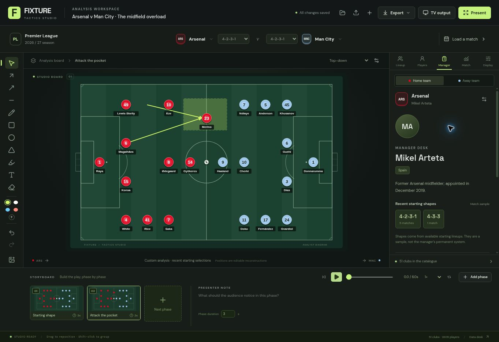

# Fixture · Tactics Studio



A football analysis workspace for the Fixture weekly show, by Bang On Entertainment. Built for studio touchscreens, a mouse, and a clean second display or OBS browser source.

## In the studio

1. **Choose teams** from the 20 Premier League clubs and 36 Champions League league-phase clubs for 2026/27. Five overlapping memberships are deduplicated into 51 clubs. The bundled catalogue contains 1,609 squad records.
2. **Load a match** for its available confirmed starting XIs, formations, score, team statistics and key events. Recent selections are explicitly labelled when a confirmed match XI is unavailable. Search another fixture date through the live data route.
3. **Build the explanation.** Drag players or the ball; Shift-click players to move a group. Draw pass arrows, dashed runs, connection lines, freehand marks, zones, circles, three-point areas, spotlights and text. Click an annotation in Select mode to edit its style in Display. Undo/redo works per completed action.
4. **Use the inspector.** Lineup supports squad substitutions and 12 formation templates. Players opens profiles for every squad member, including the bench. Manager includes a short bio, separately sourced identity, observed starting formations and editable scouting notes. Match compares the supplied home/away statistics and key events.
5. **Create the sequence.** Add a phase, move the players, name the moment and add a presenter note. Play, scrub, loop or change speed. The storyboard interpolates stable player identities and the ball between keyframes.
6. **Send it to air.** TV output opens a clean synchronised window; move it to the studio display or capture that window in OBS. Present gives a touchscreen layout. Export a 3840×2160 PNG, a 1920×1080 animation, or an editable `.fixture.json` document.

Video export uses the browser's supported MediaRecorder format (usually WebM in Chromium; MP4 when available). It does not promise MP4 on every browser. Reference video is muted. Animations record in real time; keep the tab visible.

### Controls

| Key | Action |
| --- | --- |
| V / A / R / L | Select / pass arrow / movement / connection |
| D / Z / O / G | Freehand / zone / circle / three-point zone |
| H / T / E | Spotlight / text / erase annotation |
| K / Space / F | New phase / play-pause / presenter mode |
| Ctrl or Cmd + Z | Undo |
| Ctrl or Cmd + Shift + Z | Redo |
| Ctrl or Cmd + S | Save |
| Arrow keys / Shift + arrows | Nudge selected players / larger nudge |
| Delete / Escape | Delete selection / clear selection |

## Data and persistence

The shipped snapshot was checked on **30 October 2026** and works without an API key. It contains 134 fixtures/results and 84 match summaries, plus competition-scoped player statistics. Use the in-app Data desk to inspect provenance and refresh a selected squad. The Vercel Function supports daily fixture lookup and additional match summaries. Source outages leave the bundled catalogue usable.

Player information includes supplied shirt number, position, nationality, birth date, height, weight and season statistics. Missing fields remain unknown. We do not manufacture preferred foot, injury status, xG, heatmaps or optical tracking. Manager identity comes from separately checked sources because roster coach fields can be stale. Formation frequency is a small match sample; the editorial analysis lens is a discussion prompt, not a measured metric.

Analyses autosave in this browser's local storage. The library retains up to 60 document entries. Export JSON for backup and transfer; imported documents receive new IDs. Attached reference images/video stay in IndexedDB in this browser. JSON exports contain their reference, not the media file, so reattach the original on a different device.

TV output uses same-origin BroadcastChannel and storage events. It synchronises windows in the **same browser profile on the same computer**. Cross-device remote operation and multi-user cloud collaboration are not implemented. An independently running OBS browser engine must load an exported/prepared analysis in its own profile; a window capture of the opened TV output mirrors the live operator immediately.

## Run locally

Requires Node 24 (Node 22.12+ also supports the Vite build) and npm. Python 3.10+ is needed only to rebuild the data snapshot.

```bash
npm ci
npm run dev
npm test
npm run build
```

The Vite development server reuses `api/football.js`; deployment uses a native Vercel Function. No secrets or paid integrations are required.

To rebuild the snapshot:

```bash
npm run data:refresh
```

Raw source responses are cached in ignored `data-cache/`. Review `data/managers.json` against its identity sources whenever managers change. Rebuild, review coverage, run tests and commit the new snapshot before deploying it. Data refresh is explicit; no unattended schedule or provider SLA is implied.

## Deploy

Live app: [fixture-tactics-studio.vercel.app](https://fixture-tactics-studio.vercel.app/). Source: [kierantrestain/Tacticsboard](https://github.com/kierantrestain/Tacticsboard).

The initial production release was deployed from the committed source through the Vercel API. Vercel’s Git integration returned `repo_no_access` for this repository, so automatic deployments from GitHub are not connected. The repository owner can grant Vercel access and connect this existing project in Settings → Git; do not create a duplicate project. See the production handoff for the exact project.

Import this repository into Vercel with framework **Vite**, build `npm run build`, output `dist`, Node **24.x**. `vercel.json` supplies SPA routing and security headers; `/api/football` is deployed separately. No environment variables are needed. Production is the `main` branch. Run `npm test && npm run build` before promotion.

See [the foundation review](docs/FOUNDATION_REVIEW.md), [data provenance](docs/DATA_PROVENANCE.md), [production handoff](docs/PRODUCTION.md) and [third-party notices](THIRD_PARTY_NOTICES.md).
