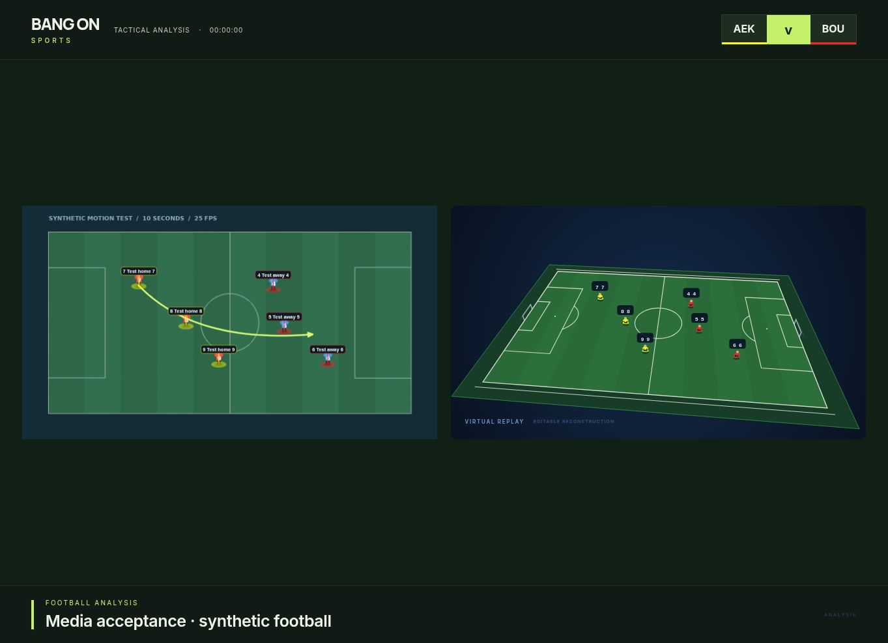

# Media analysis in 5.2

This is the historical 5.2 release record. Studio 6 preserves this layer and adds complete bounded-volume backup for sources over 200 MB; external trimming is no longer the only transfer route. Use [OPERATOR_V6.md](OPERATOR_V6.md) for current instructions.

This release improves the existing source viewer, local media store, telestration, calibration/tracking, still builder, rundown, 3D renderers, programme output and exporters. It does not introduce a second analysis engine.

## Producer workflow

1. Use **Import** or drop files into the app. Preview a batch before importing. Unsupported files have their own error and do not discard successful imports. The media workspace includes searchable thumbnails, match/segment grouping, rename, tags, notes and original reference timestamps. Open a source directly into analysis.
2. For a recording, use the full-source filmstrip and original timestamp fields to choose the relevant passage. Clips normally start at 20 seconds; the analysis range can extend to 60 seconds. Duplicate a clip or split it at the cursor into independent saved shots. Set playback speed, loop, bookmark or add explanation pauses. Reverse is a silent review aid using backward seeks.
3. In **Picture**, zoom/pan, crop, rotate and adjust brightness/contrast. Crop and rotation transform the media and its ink together; calibration coordinates remain tied to the original image. **Original / Annotated** is the before/after control. A freeze frame carries source provenance, visible editable annotations, picture settings, calibration and sampled player observations. It opens immediately as a still.
4. Draw a circle, arrow, curved run, area, defensive line, spotlight, text or numbered step. Choose **Move**, select the graphic and use the resize handles. The Graphics panel edits text, style, opacity, weight, curvature, visibility and appearance/disappearance times. Undo/redo and per-layer hiding remain available. Timed screen and pitch layers are saved with the shot.
5. In **Reconstruction**, map four visible pitch landmarks, identify actors and confirm their team/identity. Track the passage, inspect flagged samples, correct feet positions and reject or restore an observation. Any correction/rejection clears review approval. Confirm the calibration and markers before using tactical replay. Tracking remains capped at 20 seconds even for a longer analysis passage.
6. For a picture sequence, map/review each image and assign common player identities. Choose two to twenty stills in order. Each keeps its own annotations and reference timestamp. The builder starts a new editable sequence by default; an explicit append option retains the current storyboard. Saved show moments remain independent, and undo restores the previous draft. Movement between stills is illustrative.
7. In **Present**, prepare original, annotated, 2D, 3D and side-by-side views as one ordered rundown segment. Tactical views require reviewed observations. Source-derived 2D sequences contain the source's phases, without an unrelated starting formation. Save/recall preserves trim, player assignments, review status, timed ink, picture settings, camera pose, playback speed, notes and graphics. Preparing views and opening another source hold programme output.
8. Recall and modify each shot, then explicitly **Take to TV**. Programme uses the same picture settings and supports source-versus-3D output with a fitted 16:9 replay pane. Brief view transitions do not remount or restart the source. Source reconstructions do not invent a ball marker.
9. Export a clean 4K PNG or silent 1080p/25 fps film. The film summary states duration, speed and format. Slow motion changes travel time while explanation pauses retain their wall-clock duration. Preview the completed film in the app. Export a portable ZIP to retain source bytes and move the complete analysis; JSON alone does not include media.

## Limits and evidence

| Area              | Behaviour                                                                                                                                                                                                                                                                                    |
| ----------------- | -------------------------------------------------------------------------------------------------------------------------------------------------------------------------------------------------------------------------------------------------------------------------------------------- |
| Source size       | Up to 2 GB, subject to available browser storage. Blob storage, native playback and bounded metadata/frame reads avoid a whole-recording JavaScript copy. This is not a guarantee every device can handle 2 GB.                                                                              |
| Analysis/tracking | Up to 60 seconds per analysis passage; up to 20 seconds per tracking run. Short clips remain the normal workflow.                                                                                                                                                                            |
| Portable project  | The existing 200 MB portable ZIP limit remains. A larger source can be analysed locally but must be trimmed externally for a portable pack within this limit.                                                                                                                                |
| Film              | Silent 1080p, 25 fps, maximum 180 seconds of rendered output. Browser codec support determines available formats. Original source audio stays with native source playback and is not remuxed into analysis films.                                                                            |
| Frame stepping    | Decoded presentation timestamps where WebCodecs/codec support permits. Otherwise the UI explicitly labels stepping approximate. The filmstrip and keyboard interval are navigation aids, not verified frame indices.                                                                         |
| Formats           | Containers such as MOV do not guarantee a decodable codec. Import previews detect unsupported sources before they enter the library.                                                                                                                                                         |
| Relink/replace    | Same type and dimensions; replacement must cover saved analysis timestamps. A changed source invalidates current and saved tracking reviews. Shared saved projects and held programme sources block replacement. The first/last-chunk signature is sampled, not a full-file integrity proof. |
| Deletion          | Sources referenced by saved analysis, tracking or ink are protected. Rename/group operations retain stable source IDs.                                                                                                                                                                       |
| Tracking truth    | Only visible, sampled observations are shown. Rejected points are omitted and are not interpolated into. Still-to-still motion remains illustrative. No reliable ball detection, automatic offside judgement or exact speed measurement is claimed.                                          |
| Devices           | Physical dual-tablet operation, studio GPU paths, long licensed match recordings and broadcast hardware need an on-site rehearsal. Automated tests and synthetic media do not certify television hardware reliability or tracking accuracy on real matches.                                  |

## Verification record

The release was tested with a generated 10-second, 25 fps, 1280×720 football motion fixture, three separately timestamped freeze frames, landscape and portrait PNGs, and an intentionally invalid MOV. No broadcast recording was downloaded or used as unlicensed test media.

- Automated regression suite: 261 tests across 28 files passed. Covers media validation, unified project/media import routing, immediate explicit moment saving, crop/rotation geometry, visibility, curves, source duplication/replacement, clip splitting, saved view settings, reviewed reconstruction, rejected observations, private source-only 2D preparation, still identity/provenance, portable ZIP round trips, playback rates, variable decoded frame timestamps and decoder/sample disposal.
- Full production build passed: TypeScript, Vite, 134 statistical report checks, pinned vision model preparation and the downloadable Studio Hub package.
- Browser checks before the final release pass: mixed batch import with isolated codec failure; metadata save/open; rotate/draw/curve/resize; saved picture/ink reopening; explicitly approximate stepping; freeze-frame provenance; manual calibration and two-actor tracking over 13 samples; reject/restore/review; original/annotated/2D/3D/comparison shot creation; programme recall and three reviewed stills linked into editable phases.
- Final managed-preview checks: imported a complete synthetic ZIP through the main Import button; reopened the original/annotated/2D/3D/comparison views; verified a source-only 2D sequence, independently rebuilt and saved three stills, modified/reopened a freeze-frame picture at 105% brightness and recalled its programme output. The saved annotated clip reopened at 0.5× speed. Source-versus-3D output showed the full pitch with no invented ball. A downloaded PNG was verified at 3840×2160.
- Secure preview in Chrome: rendered a six-second tactical sequence at 0.5×. The completed MP4 played in the application's film preview; native video metadata reported 12 seconds, 1920×1080, readyState 4 and no error. The download-event harness timed out for ZIP/MP4 downloads, so those file-download round trips are not claimed as browser-verified; source ZIP import and the actual ZIP byte/model round trip are verified separately.
- Exact decoded frame access is regression-tested with variable presentation timestamps and resource disposal. Browser QA exercised the explicitly approximate HTTP fallback; native per-frame decoding on representative licensed VFR match recordings remains an on-site check. The HTTP preview used the compatibility 3D renderer; physical tablets and studio GPU rendering still need rehearsal.

## Release control

Work is committed to `main` as requested. `vercel.json` disables Git-triggered deployments of `main` so a code push does not publish production. A preview may be built explicitly for review. Production deployment requires approval and a deliberate release; do not remove this guard as an incidental cleanup.
